<div align="center">


<a href="https://github.com/Prithvi-Web">
  
</a>

<br/>


<br/><br/>


<br/><br/>

<sub>Everest, Lhotse and Nuptse, drawn one bit at a time</sub>

</div>

<br/>

```console
vinay@github:~$ whoami
vinay // builder, product thinker

vinay@github:~$ cat now.txt
open source tools, desktop apps, and a lot of late night experiments

vinay@github:~$ ls projects/
TreeMap-Disk-Visualizer/   EnvVault/   (and a few things not public yet)
```

<br/>

<div align="center">

## Live feed

<sub>Everything in this section is regenerated from the GitHub API every hour by a GitHub Action. No stale screenshots.</sub>

<br/><br/>
<br/><br/>
<br/><br/>
<br/><br/>
<br/><br/>

<br/>

## Bit arcade

<sub>Both games play themselves. Spectator mode only.</sub>

<table align="center">
<tr>
<td></td>
<td></td>
</tr>
</table>

<br/>

## The snake is hungry

<picture>
  <source media="(prefers-color-scheme: dark)" srcset="assets/snake-dark.svg"/>
  
</picture>

<br/>

## Tech stack

<sub>Based on the languages in my repos. Icon names: <a href="https://skillicons.dev">skillicons.dev</a></sub>


<br/><br/>

## Streak


<br/><br/>


</div>
