 

 

<table align="center">
<tr>
<td width="340" align="center">
  
   <code>01110000 01101001 01111000</code> drawn one bit at a time
</td>
<td valign="middle">

### hey, i'm Vinay

I build software products and I like turning rough ideas into things that ship.
Right now that means open source tools, desktop apps, and a lot of late night experiments.

- Currently building: **TreeMap Disk Visualizer**, **EnvVault**, and a few things not public yet
- Obsessed with: clean interfaces, fast feedback loops, products with a point of view
- Ask me about: shipping, product strategy, startups, tennis

</td>
</tr>
</table>

 

## Live stats

Everything below is regenerated from the GitHub API every hour by a GitHub Action. No stale screenshots.

  

  

  

 

## The snake is hungry

<picture>
  <source media="(prefers-color-scheme: dark)" srcset="assets/snake-dark.svg"/>
  
</picture>

 

## Tech stack

Edit the <code>i=</code> list to match what you actually use. Icon names: <a href="https://skillicons.dev">skillicons.dev</a>

  

## Streak and trophies

  

